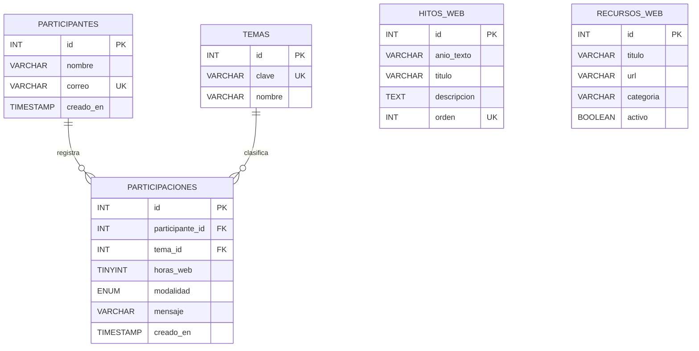

# Modelo entidad-relación (ADA 4)

Este modelo representa las cinco tablas del archivo `conexion_web_ada4.sql`. Las relaciones se implementan con claves foráneas y permiten registrar participaciones asociadas a un participante y un tema.

Las tablas `hitos_web` y `recursos_web` son catálogos informativos independientes. `participaciones` depende de `participantes` y `temas`; sus filas se guardan mediante la aplicación PHP. Todas las tablas se crean automáticamente con el script SQL.
